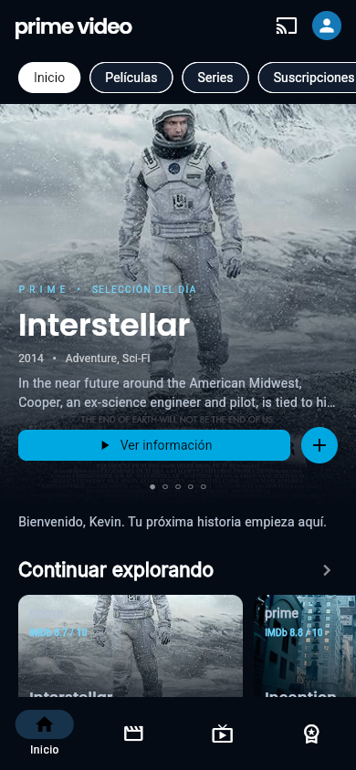
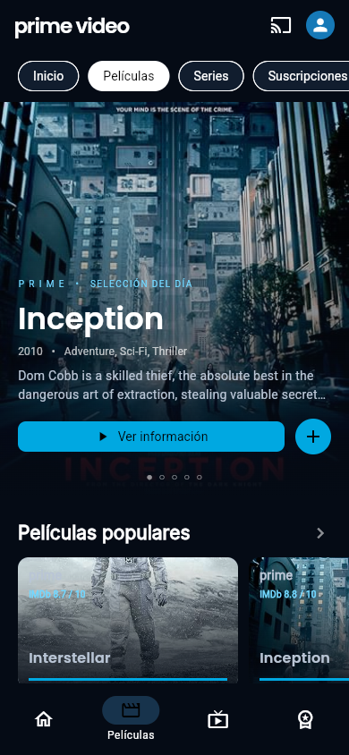
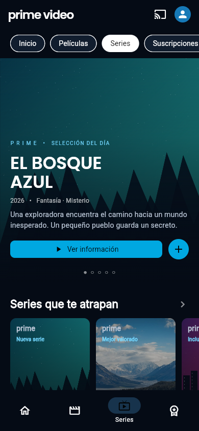
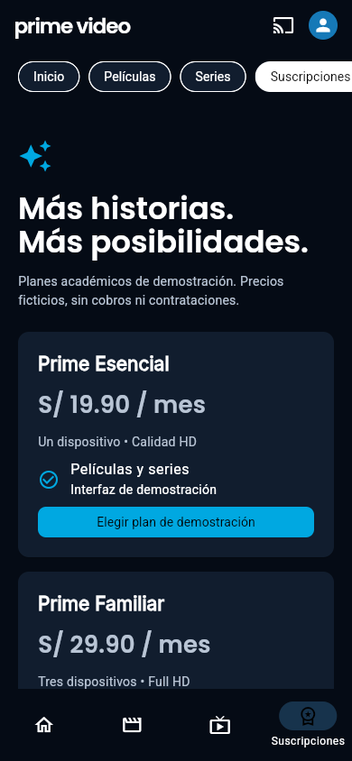
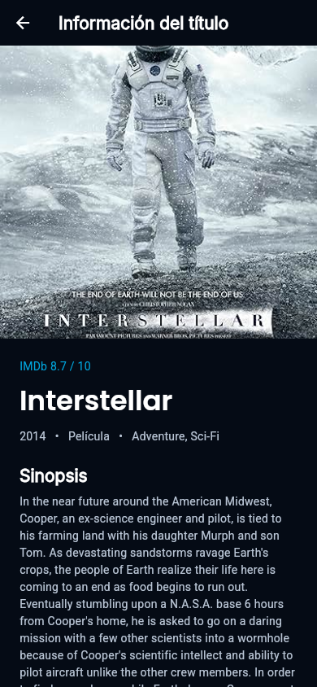

# Laboratorio 9–10 · Prime Video con Flutter

**TECSUP · Desarrollo de aplicaciones móviles · Kevin**

Interfaz móvil inspirada en Prime Video, desarrollada con Flutter y Material Design. Integra películas reales desde OMDb y demuestra los componentes solicitados en la rúbrica académica.

[Repositorio](https://github.com/Chanok18/lab9_10) · [Validación](VALIDACION.md) · [OMDb API](https://www.omdbapi.com/)

## Vista previa

Capturas de la aplicación ejecutándose en Chrome a **390 × 844 píxeles**, con películas obtenidas desde OMDb.

| Inicio | Películas | Series |
| :---: | :---: | :---: |
|  |  |  |

| Suscripciones | Detalle |
| :---: | :---: |
|  |  |

## Objetivo

Recrear la composición visual de una plataforma de entretenimiento y practicar widgets, listas, mapas, rutas, consumo de una API e imágenes locales y remotas. El proyecto es académico: no ofrece streaming, pagos ni autenticación con Amazon, y no es una aplicación oficial de Prime Video.

## Herramientas

- Flutter **3.35.3** y Dart **3.9.2**.
- Material Design 3 y Visual Studio Code.
- Paquete `http` para consultas HTTPS a OMDb.
- Chrome para verificación; Android como plataforma objetivo.
- Node.js 22 opcional, únicamente para automatizar capturas.

## Funcionalidades y pantallas

| Pantalla | Contenido |
| --- | --- |
| **Inicio** | Bienvenida, banner destacado, carruseles, recomendaciones y acceso a planes |
| **Películas** | Seis películas de OMDb, posters, puntuaciones y acceso al detalle |
| **Series** | Carrusel y listado con descripciones del catálogo de demostración |
| **Suscripciones** | Tres planes ficticios y mensajes de demostración, sin cobros |
| **Detalle** | Imagen, título, sinopsis, género, año, fuente de información y favoritos |

Las categorías superiores y la barra inferior cambian de sección. Tocar un poster abre su detalle. El avatar abre **Mi lista**, donde se pueden consultar y eliminar favoritos. Estos se conservan en memoria durante la sesión y se reinician al cerrar o recargar la aplicación.

## Instalación y ejecución

### 1. Clonar e instalar dependencias

```powershell
git clone https://github.com/Chanok18/lab9_10.git
cd lab9_10
flutter pub get
```

### 2. Configurar OMDb

Solicita y activa tu propia clave en [OMDb API Key](https://www.omdbapi.com/apikey.aspx). Copia la plantilla local:

```powershell
Copy-Item omdb.example.json omdb.local.json
```

Edita `omdb.local.json` y coloca tu clave:

```json
{
  "OMDB_API_KEY": "TU_CLAVE_ACTIVADA"
}
```

`omdb.local.json` está excluido de Git. Cada persona debe configurar su propia clave; el repositorio no incluye credenciales.

### 3. Ejecutar en Chrome

```powershell
flutter run -d chrome --dart-define-from-file=omdb.local.json
```

En VS Code también puedes seleccionar **Prime Video • OMDb (Chrome)** y presionar **F5**, después de crear el archivo local.

Para explorar el diseño sin una clave:

```powershell
flutter run -d chrome
```

En ese caso se muestra el catálogo ficticio incluido en el proyecto y no se consulta OMDb.

### 4. Ejecutar en Android

Conecta un teléfono con depuración USB o inicia un emulador:

```powershell
flutter devices
flutter run -d ID_DEL_DISPOSITIVO --dart-define-from-file=omdb.local.json
```

Flutter debe estar disponible en el PATH. Android incluye el permiso `INTERNET` para consultar la API y descargar imágenes. La compilación y ejecución en un dispositivo Android están pendientes de validar.

## Integración con OMDb

El servicio `lib/data/omdb_service.dart` consulta seis IMDb ID mediante HTTPS: **Interstellar, Inception, Dune, The Matrix, The Dark Knight y Spirited Away**. Convierte el JSON en objetos `Contenido` con título, sinopsis completa, género, año, puntuación y URL del poster.

- La carga se realiza una vez al iniciar; cambiar de categoría no repite las consultas.
- Inicio, Películas, Detalle y favoritos comparten el catálogo cargado.
- Hay progreso de carga, tiempo máximo de espera, mensajes de error y reintento.
- Ante errores se conserva el catálogo de demostración.
- Los posters ausentes usan un recurso local; la descarga de imágenes incluye carga y alternativa visual ante errores.
- Las series mantienen los ejemplos del laboratorio.
- Las sinopsis se muestran en el idioma devuelto por OMDb. Los títulos no implican disponibilidad en Prime Video.

La clave se inyecta al compilar mediante `dart-define`. En una aplicación cliente compilada puede ser inspeccionada; esta configuración directa corresponde al alcance académico del laboratorio.

## Componentes de la rúbrica

| Componente | Dónde se demuestra |
| --- | --- |
| `ListView` | Desplazamiento vertical de Inicio, Películas y Series |
| `ListView.builder` | Carruseles horizontales y lista de favoritos |
| `ListTile` | Series, películas, beneficios y favoritos |
| `Row` y `Column` | Botones en fila y composición vertical de textos |
| `List` y `Map` | Catálogo tipado, planes y lectura de JSON |
| `Navigator` y rutas | Ruta `/detalle` con un objeto `Contenido` como argumento |
| `ThemeData` | Fondo oscuro, colores y tipografías compartidas |
| `Card` | Posters y tarjetas de planes |
| `SingleChildScrollView` | Detalle y Suscripciones |
| `Image.asset` | Arte local de demostración |
| `Image.network` | Posters OMDb y fotografía de Horizonte, con `loadingBuilder` y `errorBuilder` |

El código incluye comentarios académicos breves en español junto a los componentes principales.

## Tipografías y recursos

Las tres familias se distribuyen localmente y están registradas en `pubspec.yaml`:

| Familia | Uso |
| --- | --- |
| **Poppins SemiBold** | Títulos principales y texto sobre posters |
| **Inter** | Encabezados de secciones y tarjetas de planes |
| **Roboto** | Descripciones, botones y textos generales |

Las fuentes provienen de [google/fonts](https://github.com/google/fonts) y se incluyen sus licencias SIL Open Font License en `assets/fonts/LICENSE-*.txt`.

Las imágenes `orbita.png`, `ciudad.png`, `marea.png` y `bosque.png` son placeholders geométricos originales. Los títulos del catálogo de demostración son ficticios. Pueden reemplazarse por recursos propios o autorizados manteniendo los nombres o actualizando `catalogo_data.dart`.

La serie Horizonte utiliza una [fotografía de Unsplash](https://images.unsplash.com/photo-1464822759023-fed622ff2c3b), sujeta a la [licencia de Unsplash](https://unsplash.com/license). La información y los posters de películas proceden de [OMDb](https://www.omdbapi.com/), que identifica su contenido bajo **CC BY-NC 4.0**; se atribuyen en Detalle para este uso académico no comercial. Las capturas de referencia se usaron para estudiar la composición visual.

## Estructura

```text
lib/
├── main.dart
├── theme/app_theme.dart
├── models/contenido.dart
├── data/
│   ├── catalogo_data.dart
│   └── omdb_service.dart
├── screens/
│   ├── inicio_screen.dart
│   ├── peliculas_screen.dart
│   ├── series_screen.dart
│   ├── suscripciones_screen.dart
│   └── detalle_screen.dart
└── widgets/
    ├── app_navigation.dart
    ├── contenido_card.dart
    ├── contenido_carousel.dart
    └── featured_banner.dart
assets/
├── fonts/
└── images/
test/
├── widget_test.dart
└── omdb_service_test.dart
docs/capturas/
tool/verificar_chrome.mjs
omdb.example.json
```

## Pruebas y validación

```powershell
dart format lib test
flutter analyze
flutter test
```

Última validación del **31 de octubre de 2026**:

- Dependencias resueltas y código formateado.
- `flutter analyze`: sin incidencias.
- `flutter test`: **11 pruebas aprobadas**.
- Navegación, scroll horizontal y vertical sin desbordamientos detectados a 320, 390 y 760 píxeles.
- Detalle, favoritos, estado vacío y mensajes de planes verificados.
- Pruebas de OMDb con respuestas simuladas, cuotas, claves inválidas y campos `N/A`.
- Consulta real desde Chrome: seis películas y seis posters con HTTP 200, sin excepciones de aplicación detectadas.

El informe completo está en [VALIDACION.md](VALIDACION.md). No se generó un APK ni se probó un emulador o teléfono Android.

### Actualizar capturas (opcional)

Con Node.js 22 y Chrome en su ubicación estándar de Windows, inicia la app:

```powershell
flutter run -d chrome --web-port 7359 --dart-define-from-file=omdb.local.json
```

En otra terminal:

```powershell
node tool/verificar_chrome.mjs
```

Las imágenes y el informe de red se guardan en `docs/capturas/`. Los parámetros de consulta se omiten del informe para evitar guardar la API key.

## Conclusiones

1. Aprendí a separar las pantallas y reutilizar widgets para mantener una interfaz consistente.
2. Comprendí cómo transformar una respuesta JSON en un catálogo y compartir los datos entre pantallas con navegación y favoritos.
3. Practiqué imágenes locales y remotas, manejo de errores y pruebas para adaptar el diseño a distintos tamaños de celular.
